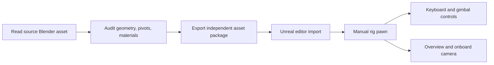

# Manual AIM sentry example

## 0. Terminology

Manual asset rig: a hierarchy of visual chassis, wheels, yaw and pitch parts with local pivots and materials. A manually driven kinematic pawn is an initial interactive example, not a calibrated vehicle dynamics model.

## 1. Decisions and constraints

User steering explicitly prioritizes the existing vehicle under `E:\WarThunderModding` and allows manual control before autonomous integration. Use the real `aim_sentry.blend` source without modifying its source directory. Keep original geometric dimensions and report any conversion; do not copy War Thunder gameplay mass, calibre or ammunition into supposed RoboMaster physical truth.

UE5 remains the target runtime. Its absence is a recorded external dependency, not authorization to silently replace the platform. Physical parameters without source evidence remain uncalibrated. Initial scope: mesh/material import, manual driving with collision, gimbal controls and a camera/overview. ROS closed-loop, full rules and multiplayer remain subsequent milestones.

## 2. Data and orchestration

2026-11-15 user steering: the first compiled/imported runtime passed nine kinematic checks, but the user now requests War Thunder-style controls. W/S throttle/reverse, A/D hull rotation, Space brake, mouse camera/aim, C free look preserving world aim, Shift scope and wheel zoom replace the old WASD translation/QE rotation profile. New input/view behavior requires separate verification. Source conventions and chosen simplifications are in docs/research/manual-controls-reference.md.

### 2.1 Data

Before: source Blender asset and War Thunder-specific rig/material conventions. After: a separate local asset package containing source hashes, FBX part geometry, standard PBR material inputs and a versioned manual rig manifest. Export/consumer agents agree on exact fields before code; document them in the asset guide. No arbitrary package script executes during runtime import.

### 2.2 Flow

Only the copied/exported package can be modified. Unreal compilation, startup, screenshot and movement logs must exist before those respective capabilities are marked verified. Errors on unsupported meshes or materials are explicit.

### 2.3 Mount points

Asset export script, exported package, Unreal project/runtime, editor import script, build/run entrypoints and manual guide.

### 2.4 Steps

1. Inspect source objects, groups, mesh/material provenance and transform conventions.
2. Export grouped geometry, texture inputs and a deterministic rig contract.
3. Implement Unreal loading, manual control, collision and camera display.
4. Compile and run with a real installed engine; verify geometry, wheel/turret motion, camera and controls.

### 2.5 Structural health

New asset scripts belong in `tools/assets`; UE source/config in `unreal/RMSim`; generated source-derived vehicle assets in `assets/vehicles/aim_sentry`; evidence in `artifacts/assets` and `artifacts/unreal`; user instructions in `docs/guides`. No refactor of the original War Thunder project.

## 3. Acceptance contract

- A1: Original `.blend` remains hash-identical after export, and the package identifies its source.
- A2: Body/yaw/pitch/wheel meshes and materials load with documented dimensions and pivots.
- A3: Manual input produces chassis translation/rotation and gimbal movement in Unreal; collision prevents crossing solid test obstacles.
- A4: Both an external view and onboard camera display the imported model/scene correctly.
- A5: Build/run instructions are reproducible and failure reports are actionable; unsupported or unverified platforms are not marked passed.
- Boundary: no claim of accurate wheel-ground physics, physical calibration, ROS autonomy or multiplayer acceptance from this example.

## 4. Architecture integration

Record actual asset pipeline and runtime source separately from compile/run evidence. Update current progress after each logical change. The system roadmap retains native dual-platform same-source algorithms and competition goals after this manual milestone.
