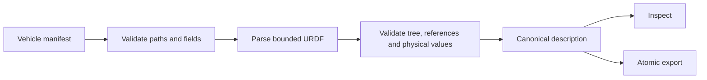

# Vehicle package v1

## 0. Terminology

- Vehicle package: a local directory containing `vehicle.json`, a URDF and optional local model assets.
- Canonical description: validated SI/right-handed robot data consumed by the engine adapter. It is not a physics simulation or a ROS node.
- Supported import: a bounded subset of URDF; unsupported semantics produce actionable errors rather than being silently discarded.

## 1. Decisions and constraints

The project began empty. The user requested plug-in new vehicle import and consistent native Windows/Ubuntu source. First implement one cross-platform package format with two independently parameterized sample vehicles. No package may execute arbitrary scripts. No UE, ROS, calibrated dynamics, full match or multiplayer claim follows from importer success.

Default complexity: standard-library Python 3.10+ tooling. Keep static assets, schemas, source, tests, generated artifacts and documentation in separate type-specific directories. No conversion dependency is necessary for the first primitive URDF samples.

## 2. Data and orchestration

### 2.1 Data

Previously no package contract existed. `vehicle.json` version 1 supplies `id`, `display_name`, `model`, `control`, and `sensors`. The authoritative exact fields live in `schemas/vehicle-v1.schema.json`; the roadmap records the shared contract. URDF supplies links, inertial tensors, primitive visual/collision shapes, fixed/revolute/continuous joints and bounded local mesh references. Mesh references being validated does not promise engine-side mesh loading.

Example: `validate assets/vehicles/sentry_omni` succeeds; an escaped model path or cyclic joint graph fails with exit 2. `export ... --output artifacts/vehicles/sentry_omni.json` writes deterministic canonical geometry/joints/sensors/control and source hashes only after validation.

### 2.2 Flow

Reject absolute/escaping paths, external URLs, DTDs, duplicate identifiers, nonfinite numbers, invalid geometry, invalid inertia and unresolved joints. Errors must leave source files unchanged and must not write partial exports. Deterministic exports permit review and regression checks.

### 2.3 Mount points

Python module CLI, JSON schema, vehicle asset directories and test discovery are the only initial mounting points. An engine consumer is a separate feature.

### 2.4 Steps

1. Define and validate manifest and filesystem boundaries.
2. Parse URDF graph and physical metadata into canonical data.
3. Add two sample vehicles and CLI inspect/export.
4. Exercise valid, malformed and escaped packages; record real command evidence.

### 2.5 Structural health

No refactor is required in this empty repository. Source belongs in `src/rm_vehicle_tools`, examples in `assets/vehicles`, tests in `tests/vehicle_tools`, generated data in `artifacts/vehicles`. Do not put runtime caches or downloaded engines into source directories.

## 3. Acceptance contract

- S1: Both sample packages validate, with distinct IDs, geometry and wheel placement.
- S2: Canonical exports contain a single rooted link tree, sensors, control references, SI units and source digests; repeated export is identical.
- S3: Broken references, cycles, duplicates, invalid masses/inertias, nonfinite fields and path escapes fail clearly.
- S4: Failed export does not create partial output or overwrite an input file.
- S5: CLI works from the repository using the documented cross-platform Python invocation.
- Boundary: no unsupported format silently succeeds; importer success is not UE or ROS runtime acceptance.

## 4. Architecture integration

On acceptance, record the real importer/CLI/schema responsibilities and limitations in architecture. Update the roadmap only for this bounded feature. Whole-system requirements remain incomplete until the independent runtime, native dual-platform and match checks pass.
