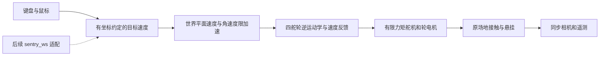

# 舵轮控制与小陀螺

## 0. 契约

ROS坐标X前/Y左/Z上，线速度m/s，角速度rad/s。控制输入是目标速度，不是位置/姿态强制更新。原地图、模型原尺度与真实接触保留。

## 1. 决策与约束

用户最终确认普通/小陀螺两种模式均为W/S沿镜头前后、A/D左右平移，鼠标控制云台瞄准/俯仰。G只开关小陀螺，Z/X降低/提高自转设定，HUD同时显示设定和实测值。Q/E保留普通模式手动车体旋转。松开移动键主动较快减速，Space更强制动。

轮胎增加抓地，物理圆轮和舵向区分沿轮面滚动与横向侧滑；坡上停车由轮电机主动制动维持。验证顺坡/横坡和停车状态，不用对车体施加与接触无关的固定阻力来伪造防滑。对接前核查sentry_ws控制链与坐标，不把本地演示控制器冒充其真实控制算法。

当前9刚体差速模型锁住舵向，不能满足边自转边固定方向平移。原build_model.py和舵轮轮组几何支持独立Z轴舵向；将4carrier从滑动模块分离，形成15视觉部件/13刚体，4弹簧+4舵向+4轮轴约束。保持中立几何与源文件哈希。

手感参数放在车辆包drive-profile.json：速度/加减速/转向/小陀螺范围及舵机参数。键盘只产生目标速度；车体或世界坐标的SI命令通过同一控制边界，后续sentry_ws的TwistStamped适配只替换来源。当前不声称UE ROS服务端已经实现。

## 2. 实现归属与流程

导出/导入器管理suspension→steering→wheel层级；VehicleContactPhysics管理物理组件；独立VehicleDrive.cpp承载指令整形/舵轮控制，避免继续把资产初始化与控制循环挤入同一函数。GameMode管理键盘映射、G/Z/X状态与HUD，ContactProbe/新GyroProbe用真实世界帧验证。

世界平面目标在限加速度之后再按当前车体姿态转换，防止小陀螺时限幅器把旋转坐标分量误当加速度而扭曲行进方向。舵向优先选最短转角，必要时翻转轮速；转向未对齐时抑制横拖。不得调用SetActorTransform驱动通过路线；显式R复位/跌出地图恢复是单独逻辑，测试标明。

不做无关目录重组。旧接触版源/资产和全部证据保存在artifacts下作为回退点；现有技能记录约定沿用。

## 3. 验收

- 15部件唯一覆盖原33对象，中立尺寸/轮心/材质一致，原源只读。
- 手动前进目标有明确加速上限，释放/刹车/反向有连续过渡；转向实际速度明显高于旧约22deg/s，记录目标与实测曲线。
- G开关、Z/X步进及上下限生效，模式切换无突然方向翻转。
- 平地自转至少一整圈时，前进/左右平移方向仍与镜头一致；鼠标俯仰/瞄准保持世界目标。
- 红蓝波浪完整路线在小陀螺模式下通过，记录实际位姿、速度、姿态、接触；不以纯平地检查替代。
- 普通波浪、实体墙、射击、R复位和跌出地图恢复回归通过。
- 配置/接口说明与源代码一致；Ubuntu仅离线准备，ROS完整闭环和实车标定未验证。

## 4. 架构归并

更新architecture、extensible-worlds-vehicles、控制指南和progress，保留contact-vehicle专项历史成功与本次新增范围区别。完整舵轮动力学参数仍须校准；不把新控制模型扩大为完整比赛/联机实现。
