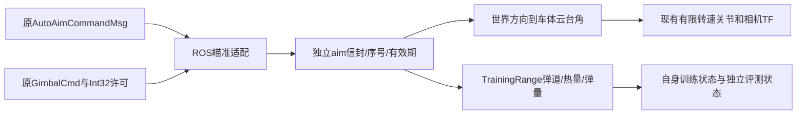

## 0. 术语与源码

固定27UL_Sentry_ws e990d98041e0787ab6abfb0b8038130f34fe1ca6内sp_msgs，pb_rm_interfaces 66c8bee0d389b0eed9e84157c26d026b95ebae4c；解释依据为该工作区固定universal_controller 95c66c2与behavior aa4d82b。保留完整消息包及来源blob哈希。

## 1. 决策与约束

本切片接行为树/视觉的高层输出，不声称原硬件GimbalController/FireController、视觉检测算法或云台动态碰撞已运行。当前云台继续用已有有限转速的运动学执行器，报告其类型；底盘真实接触路径保持。不是以此替代长期物理标定/全sentry_ws目标。

AutoAimCommandMsg的yaw/pitch为世界方向，yaw左正、pitch下正；control=false或过期立即取消自瞄/发射。GimbalCmd按该工作区Hub的pitch向上约定适配为统一pitch向下，支持速度扫描与同约定绝对位置，原行为树实际使用速度扫描。其空frame_id是已核实上游行为，固定解释为rmsim_world；其他未知frame拒绝。

auto_aim_switch Int32控制自瞄许可（0/1）；在当前连接epoch内保持，复位/断线清除，必须在新状态后重新收到许可。自瞄新鲜且control=true优先于新鲜扫描，扫描不自动开火。自瞄shoot=true只有在许可下传递到训练发射器。原Hub本身另有RC/friction门控且未直接消费shoot，本切片是明确的仿真直连接口，不冒称复刻了整个Hub仲裁。

## 2. 名词与编排

现状：RosBridgeComponent拥有底盘/电机协议与相机，TrainingRange拥有真实弹丸扫掠/HP/热量/弹量，GameMode更新手动瞄准。新增独立RosAimController，复用VehicleRig的关节执行和TrainingRange；不会直接设置命中、HP或弹量。

新增`-RosAimControl`显式取得云台/发射控制，独立于底盘所有权；`-RosBridge`仍只观察，默认手动不变。移动/鼠标观察可与外部瞄准共存。Space同时使外部瞄准停止和发射撤销，R只复位一次训练状态并更换epoch。

wire aim为19个扁平字段：7个共同身份/时间字段，加yaw_type/pitch_type、yaw/pitch、yaw_rate/pitch_rate、四个扫描边界、fire/permit。模式0保持关节、1绝对世界方向、2世界速度扫描。命令只影响aim通道的接受序号/租约，不能为底盘续期；底盘流量也不能为发射续期。错误已识别通道只停自身；无法分辨的坏帧/断线停两者。

执行在PostPhysics按Chaos时间差推进；先执行上一条已接受指令的已流逝时段，再接收下一条，避免新发射指令回填之前时间。发射器只按权威回合/热量/弹量/碰撞处理结果。自身ammo/heat/status可发给机器人，靶HP/命中细节仅进evaluation话题；不发布识别结果或真值定位TF。

挂载点：原消息包构建；rmsim_bridge可选aim适配；RosBridgeComponent的独立aim路由；GameMode显式所有权与时序；RosAimController驱动已有VehicleRig/TrainingRange。结构上新增专用组件，不把整个逻辑继续塞入GameMode；其余不做无关重构。

## 3. 验收契约

- 原生安装的原消息经独立ROS节点收发；yaw/pitch符号、混合绝对/扫描、范围反转和机械限位可测。
- 底盘转动时绝对世界瞄准稳定；实际相机TF/JointState与关节姿态一致，观察者缩放不改传感器内参。
- 许可、control和shoot组合正确；实际弹丸命中靶、扣弹/发热/冷却/限速生效，不能靠直接改HP通过。
- 停发、过期、错误frame/epoch/序号/非有限/未知控制模式、断线/复位撤销发射；两条控制租约互不续期。
- 真实R复位一次，普通手动与原速度/电机桥最小回归；Windows实跑不算Ubuntu原生。
- 验证中如按已知靶坐标算测试角度，明确是校准夹具而非真实视觉识别闭环。

## 4. 工程记录

源码快照/补丁在third_party与artifacts/sources；运行证据在artifacts/control/ros-aim-fire；指南/进度/架构按现有目录回写。长期goal保留完整传感器、真实算法、比赛、联网及地图目标。
