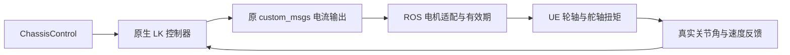

# 原 LK 节点电机闭环

现状：速度桥已工作，但其后端仍由UE本地舵轮速度/位置环执行。本机用户包包含完整LK角度/速度PID和功率限制，依赖custom_msgs。不能把已有数学提取称为原节点已运行。

变化：原目录只读复制，保留原始基线和明确补丁。原生ament_cmake构建原LK节点及完整消息包；仿真电机模式使用实际刚体相对角/速度反馈，原节点输出电流转换成有界轴扭矩，并施加等大反向反作用力。有效外部电流期间关闭UE舵向/轮速伺服，不叠加第二套速度环或移动刚体位置。

边界：复用同一个loopback组件并显式MotorControl所有权；普通手动和速度桥保持不变。电流消息本身无时间戳，所以适配器同时检查新鲜ChassisControl授权、反馈会话及两组电流消息时间，不以节点持续重复旧输出维持运动。断线、操作员制动、复位由UE租约接管停车；原emergency_stop清电流与主动停车区别记明。控制器缺少watchdog/输入有限值检查等实际问题在工作副本最小修复并留diff。

电机单位来源：AIMEtherCAT/EcatV2_Master固定7c1bd8a3c7f47cc8505470640f8dd7baf5698d76，保留完整custom_msgs源。MF电流刻度16.5/2048 A，反馈33/4096 A，角速度deg/s，编码器32768周期。轮电机0.14Nm/A来自用户功率模型；舵机常数尚无实测，单独配置为未标定演示参数，不宣称真实电机校准。原节点1ms壁钟控制周期与物理反馈频率分别记录，不声称Windows硬实时或每毫秒均有新物理反馈。

挂载点：ROS工作区原包与消息包；rmsim_bridge的可选LK适配；RosBridgeComponent的电机合同；VehicleRig的电流执行/反馈；启动旗标与车辆适配配置。均可通过不开MotorControl卸载，默认车辆行为保留。

结构：电流物理代码单独VehicleMotorDrive.cpp，ROS适配单独lk_adapter.py，复用已有transport/session/lease，不复制整个GameMode或另起服务。其余不做无关重构。

验收：原生安装节点真正收发原消息；前/横/旋转通过实际扭矩驱动物理车；轴符号/反馈量纲正确；停止发布/停止节点/断线/复位不能重放旧输入；原PID/功率路径在运行；默认手动及速度ROS桥回归通过。原源12文件哈希保持一致。Ubuntu同源离线准备，完整sentry_ws/惯量/扭矩标定/导航与比赛仍属后续。

## 原生反馈后的时序修订

native-05-fast-io的8项方向/制动门禁通过，但曲线暴露持续舵向振荡（峰值约2922deg/s），不能据8项通过宣布闭环稳定。10ms→1ms I/O与depth1已减少通信滞后，仍需处理原1ms离散PID与可变渲染物理步长的差异。

电机模式进一步采用固定1ms仿真步长，原节点通过可选feedback_driven参数在配对的新物理反馈上计算；PID按实际反馈仿真时间差缩放积分和微分，默认硬件路径比例保持1。仿真可以慢于墙钟；实测并报告real-time factor。这里不能通过随意降低扭矩常数或放宽方向阈值隐藏振荡。普通手动/速度桥仍沿原时间路径。
