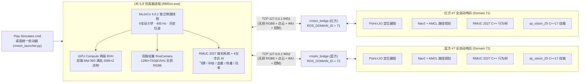

# RM Simulator (RMSim) — RMUC 2027 高保真 3v3 机甲对抗仿真器

> **UE 5.8 + MuJoCo 4.0.1 + 原生 ROS 2 Humble** · 面向 RoboMaster 机甲大师赛的 **Sim2Real 零作弊** 全栈仿真与算法验证平台

[](#)
[](#)
[-FF6F00)](#)
[-22314E)](#)

---

## 🎯 项目目标

打造一套**开箱即玩、算法同源、零真值泄露**的 RoboMaster RMUC 2027 3v3 仿真环境，既能用于**全自动哨兵算法（SLAM / 导航 / 自瞄 / 决策）的闭环迭代与对抗回归**，也能让操作手直接下场手操体验完整赛制：

- **真物理（MuJoCo 400 Hz）**：独立后台物理线程解算 6 辆车（红蓝 #7 哨兵 + #3/#4 步兵）的刚体动力学、四舵轮悬挂接触、摩擦、小陀螺与车车碰撞。
- **真传感器（0 真值作弊）**：
  - **Mid-360 激光雷达**：基于 UE5 **Compute Shader 两级 BVH** 实现 GPU 加速射线求交，支持双哨兵满血 **200,000 点/秒 × 2（40 万射线/秒）**，保留 5 µs 发射节拍、运动畸变、`offset_time`、自车雷达罩玻璃穿透与测距/测角噪声。
  - **双路自瞄相机**：红蓝哨兵各自输出真实渲染的 **`1280×720 @ 15 Hz` 无损 RGB8** 图像，直连 `sp_vision_25` C++17 神经网络识别与弹道解算。
  - **共装 IMU**：由 MuJoCo 连续子步状态生成带噪原始线加速度与角速度。
- **真赛制（RMUC 2027）**：内置官方血量/热量/功率缓冲/团队金币与免费弹池、前哨站与基地机制、飞镖系统、补给区回血买弹（`F` 键）以及 4 台会巡逻、温和对枪、残弹自动回前哨/回家补弹的内置步兵 AI。
- **车图解耦 & 离线便携**：车辆资产、地图包、物理引擎与外部 ROS 2 算法栈完全解耦；支持一键打包为**免装 UE5 / Python / ROS 2 的全离线可执行版**。

---

## 📦 下载全离线安装包（解压即玩）

不想折腾环境？直接下载已验证的 **Windows 64 位全离线一体包**（内置独立 `RMSim.exe` + MuJoCo + 全套离线 ROS 2 Humble + 红蓝双自动哨兵算法栈）：

| 版本 | 体积 | 环境要求 | 下载链接 |
| :--- | :--- | :--- | :--- |
| **RMUC 2027 全离线一体包 (Win64)** | 约 2.29 GB（解压后 ~5.08 GB） | Windows 10/11 + DX12 (SM6) 独显<br>**无需安装 UE5 / Python / Pixi / ROS 2** | **[夸克网盘直达下载](https://pan.quark.cn/s/0ffc010ac494)** |

### 🚀 3 步快速开玩
1. **解压**：将压缩包解压到**不含中文和空格**的路径（例如 `D:\RMSim\`）。
2. **首次运行库检查**（仅极纯净 Windows 需要）：若首次启动提示缺少 VC++ / DirectX 运行库，运行一次包内 `unreal\Engine\Extras\Redist\en-us\UEPrereqSetup_x64.exe`。
3. **启动**：双击根目录的 **`Play-Simulator.cmd`** 打开桌面启动器，直接点击 **启动仿真** 即可进入 6 车 RMUC 2027 3v3 实战！

---

## 🏗️ 系统架构



---

## 🎮 使用方式与操作键位

打开 `Play-Simulator.cmd` 后，启动器支持多种运行模式：
- **🏆 RMUC 2027 比赛模式（默认）**：6 车完整 3v3，可自由指定红蓝各车为「全自动 `sentry_ws`」「内置步兵 AI」或「本机手操」，默认开启 **100% 渲染比例 + TSR + 关闭主视角 Lumen + GPU 满血雷达（200k×2）**。
- **纯仿真 + 标准 ROS 2 桥**：仅启动仿真器与标准 ROS 2 桥，方便接入你自己的外部算法工作区。
- **手动试驾 / 静态靶射击训练**：无 ROS 2 依赖，轻量练车与调参。

### 手操快捷键
| 按键 | 功能 |
| :--- | :--- |
| `W` / `S` / `A` / `D` | 以云台水平朝向为基准前后/横向平移 |
| `Q` / `E`、`G`、`Z` / `X` | 普通旋转 / 切换小陀螺 / 调节小陀螺转速 |
| `鼠标移动` / `左键` / `右键` | 云台瞄准 / 发射弹丸 / 开镜放大 |
| `C` / `Shift` / `滚轮` | 按住自由环视 / 瞄准镜视角 / 镜头缩放 |
| `F` | 补给区领免费弹丸 / 本地金币买弹 / 区外远程买弹 |
| `P` | 赛前准备阶段快捷跳过（按 1 次切 10s 倒计时，按 2 次直接开赛） |
| `Space` / `Ctrl` / `R` | 加强制动 / 慢行 / 车辆复位 |

---

## 🔌 接入你自己的 ROS 2 算法

仿真器与算法端通过标准 ROS 2 话题完全解耦（默认 `robot_id=aim_sentry`，红方 `ROS_DOMAIN_ID=71`，蓝方 `ROS_DOMAIN_ID=72`）：

| 方向 | 话题 | 消息类型 | 说明 |
| :--- | :--- | :--- | :--- |
| 仿真 → 算法 | `/clock` | `rosgraph_msgs/Clock` | MuJoCo 物理时钟（需 `use_sim_time:=true`） |
| 仿真 → 算法 | `/tf` | `tf2_msgs/TFMessage` | `base_link` → `yaw_link` / 雷达 / 相机 / IMU 外参 |
| 仿真 → 算法 | `/aim_sentry/lidar/livox` | `livox_ros_driver2/CustomMsg` | Mid-360 原始点云（200k 点/秒，含 `offset_time`） |
| 仿真 → 算法 | `/aim_sentry/lidar/points` | `sensor_msgs/PointCloud2` | 标准点云格式 |
| 仿真 → 算法 | `/aim_sentry/imu/data_raw` | `sensor_msgs/Imu` | 共装 IMU 原始角速度与比力 |
| 仿真 → 算法 | `/aim_sentry/camera/image_raw` | `sensor_msgs/Image` | `1280×720 @ 15 Hz` 原始 RGB8 图像 |
| 仿真 → 算法 | `/aim_sentry/gimbal/joint_states` | `sensor_msgs/JointState` | 云台实时关节角 |
| 算法 → 仿真 | `/aim_sentry/cmd_vel` | `geometry_msgs/TwistStamped` | 底盘速度控制指令 |

---

## 🛠️ 调试与排错指南

### 1. 日志位置（排错第一时间看这里）
- **UE5 仿真器日志**：`artifacts/unreal/pure-simulator/<session_id>/ue.log`
  - 核对 GPU 雷达生效：搜索 `RMSIM_GPU_LIDAR_READY`（应显示 `rays_s=200000`）
  - 核对相机外围场馆剔除：搜索 `ROS_CAMERA_VENUE_CULL`
  - 核对 ROS 桥就绪：搜索 `ROS_BRIDGE_READY`
- **ROS 2 桥日志**：`artifacts/ros2/simulator-bridge-<pid>-<team>/stderr.log`
- **双哨兵算法日志**（Point-LIO / Nav2 / 行为树 / 自瞄）：`artifacts/navigation/external-<timestamp>/` 下的 `pointlio.log`、`navigation.log`、`behavior_server.log`、`vision_autoaim.log`

### 2. 常用命令行调试开关（`tools/unreal/Start-Simulator.ps1`）
```powershell
# 预览最终生成的 UE5 启动命令而不实际运行
.\tools\unreal\Start-Simulator.ps1 -NoLumen -GpuLidar -DryRun

# 性能优先：75% 渲染比例 + TSR（画质接近原生，GPU 压力减半）
.\tools\unreal\Start-Simulator.ps1 -NoLumen -GpuLidar -RenderScale 75

# 对比 GPU BVH 雷达与 CPU Chaos 雷达的逐射线几何精度（< 1e-3 cm 误差对拍）
.\tools\unreal\Start-Simulator.ps1 -NoLumen -GpuLidar -VerifyLidarQueries -ProfileSensorTiming

# 回退到 CPU Chaos 雷达基线
.\tools\unreal\Start-Simulator.ps1 -NoLumen -CpuLidar
```

### 3. 常见问题
- **帧率偏低 / 想冲 100 FPS**：在启动器中确保勾选 **「关闭主视角 Lumen」** 和 **「GPU 满血雷达」**，或将渲染比例从 `100%` 调为 `75%`（TSR 升采样几乎无损清晰度）。
- **进程残留**：点击启动器底部的 **「停止全部进程」** 即可一键清理 `RMSim.exe` / `UnrealEditor.exe` 与全部 ROS 2 子进程。

---

## 💻 开发者：从源码编译与一键打包

> 仅需二次开发或修改 C++/Shader 源码时才需要本节；直接试玩请直接使用上方全离线安装包。

1. **基础环境**：Windows 10/11 + Visual Studio 2022 + Unreal Engine 5.8（默认 `E:\simulator-tools\UE_5.8`，可通过 `UE_ROOT` 指定）+ Pixi。
2. **编译 UE5 编辑器模块**：
   ```powershell
   .\tools\unreal\Build-ImportLab.ps1 -EngineRoot "E:\simulator-tools\UE_5.8"
   ```
3. **编译 C++17 视觉自瞄节点（`sp_vision_25`）**：
   ```powershell
   .\tools\environment\Build-Vision.ps1
   ```
4. **一键打全离线可分发 `.zip` 包**（含独立 `RMSim.exe` + 离线 ROS 2 + 双自动哨兵）：
   ```powershell
   .\tools\unreal\Package-Standalone.ps1 -OfflineAllInOne -OutputDir artifacts/release/RMSim-RMUC2027-AllInOne-Win64 -Zip
   ```

---

## 📁 仓库结构

| 目录 | 说明 |
| :--- | :--- |
| `Play-Simulator.cmd` | 根目录唯一桌面启动入口 |
| `unreal/RMSim/Source`、`Shaders`、`Config` | UE5 运行时 C++ 源码、Mid-360 GPU Compute Shader 与渲染配置 |
| `ros2_ws/src` | 原生 ROS 2 功能包（`rmsim_bridge`、`sp_vision_25`、`behavior`、导航配置等） |
| `assets/` | 车辆包描述、传感器物理配置、RMUC 2027 赛场规则/区域/HUD 贴图 |
| `tools/` | 桌面启动器、编译/一键独立打包脚本、ROS 2 集成与环境脚本 |
| `tests/`、`docs/` | 物理/裁判/传感器回归测试与各阶段变更验收文档 |

---

## 🙏 致谢与许可说明

本项目基于并集成多项优秀开源生态：[MuJoCo](https://mujoco.org/) (Apache-2.0)、[ROS 2 Humble](https://docs.ros.org/en/humble/)、[Nav2](https://navigation.ros.org/)、[Point-LIO](https://github.com/hku-mars/Point-LIO)、[sp_vision_25](https://github.com/chenjunnn) 等；赛场与场馆原始建模源文件不随分发包单独再分发，相关来源与许可记录见 `assets/` 与 `third_party/notices/`。
